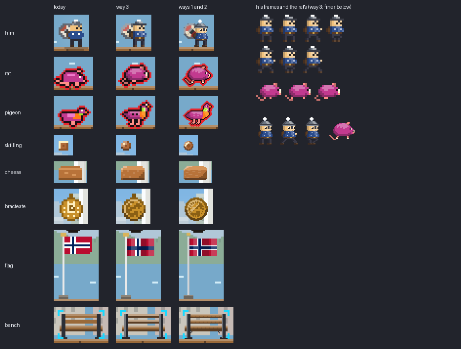
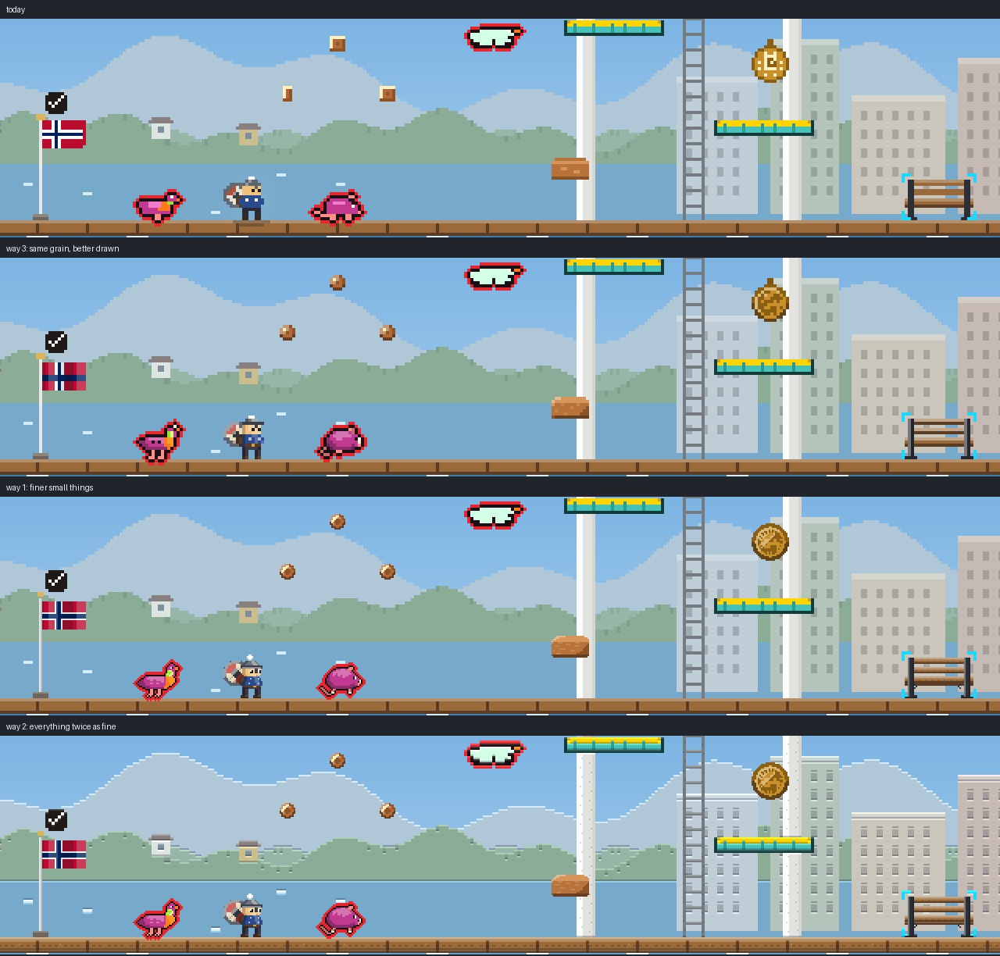
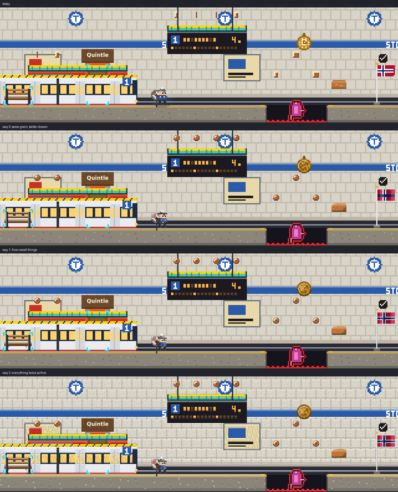
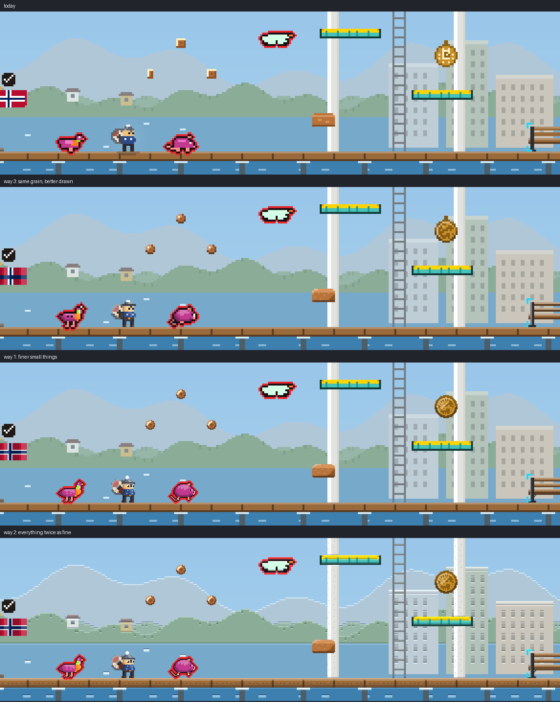
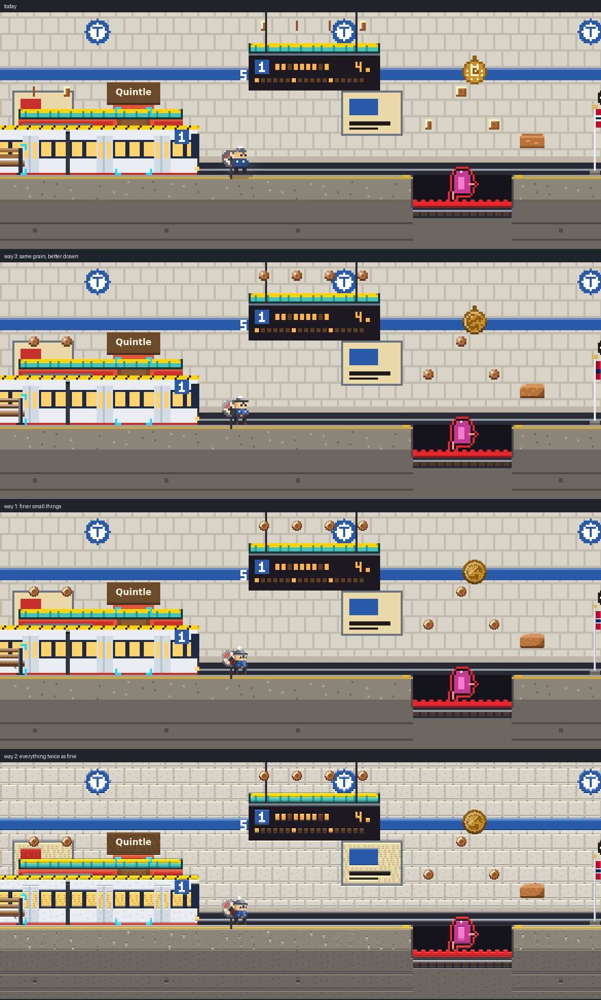
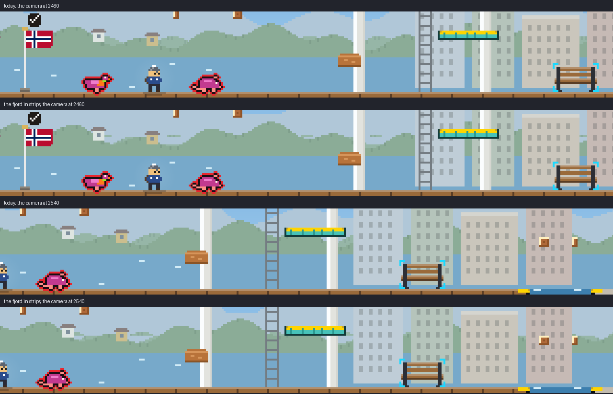

# The grain: are the pixels too big?

**Decided, 16 November 2026: way 3, the same grid, better drawn.** Lars: "do way 3 like you suggested. for the
pixels" ([ADR 0045](../adr/0045-the-grain-same-grid-better-drawn.md)). Order 23 drew him, the enemies of line 1's first
three levels, the skilling and the cheese that way; the rest follow a level at a time. The study below is kept as it was
written, before the choice.

Written 16 November 2026 for Lars, after you said: "i just fear i made a blunder with the pixel design. or rather
that the pixels are too big. they need more detail. espeiclally small items." This page says what is true, shows
three ways to more detail on two real scenes of the game, and recommends one. Nothing on this page is in the game:
the pictures come from a study you can open yourself (the addresses are at the end). It is your choice; there is no
decision record until you make it.

## What is true today

**How big an art pixel is.** The game draws everything on a grid of art pixels and scales the grid up by a whole
number of the screen's own pixels, so every art pixel is a sharp square. How many depends on the screen:

| Screen | An art pixel is | The view, in art pixels |
|---|---|---|
| A laptop window, 1280 x 800 | 4 screen pixels (8 on a sharp screen, 12 on a very sharp one) | 321 x 201 |
| A phone upright (390 x 844), plain screen | 1 screen pixel, 0.17 mm | 391 x 845 |
| The same, sharp screen (2 device pixels a point) | 3 device pixels, 0.25 mm | 261 x 563 |
| The same, very sharp (3, most phones now) | 4 device pixels, 0.22 mm | 293 x 634 |
| A phone on its side (844 x 390), any screen | 2 points, 0.33 mm | 423 x 196 |

(A phone 390 points wide is taken as 65 mm wide.) Upright, the view must be at least 240 art pixels wide, so you
can see a thrower before it throws: that is what makes the art pixels small on an upright phone, and everything with
them.

**How big the small things are.**

| Thing | Art pixels | Upright phone (0.22 mm) | On its side (0.33 mm) |
|---|---|---|---|
| Him | 10 x 14 | 2.2 x 3.1 mm | 3.3 x 4.7 mm |
| A rat | 13 x 10 (17 x 14 with its outline) | 2.9 x 2.2 mm | 4.3 x 3.3 mm |
| A skilling | 5 x 5 | 1.1 mm | 1.7 mm |
| The brown cheese | 12 x 7 | 2.7 x 1.6 mm | 4.0 x 2.3 mm |
| The shield | 12 across (8 on his back) | 2.7 mm (1.8) | 4.0 mm (2.7) |
| The feather | 5 x 9 | 1.1 x 2.0 mm | 1.7 x 3.0 mm |
| A bracteate | 12 x 12 | 2.7 mm | 4.0 mm |
| A flag | cloth 13 x 9, pole 32 | 2.9 x 2.0 mm, pole 7.1 | 4.3 x 3.0 mm, pole 10.7 |
| A bench | 22 x 13 | 4.9 x 2.9 mm | 7.3 x 4.3 mm |
| A rune stone | 16 x 16 | 3.6 mm | 5.3 mm |

So on your phone he is about three millimetres tall and a coin is one. The pixels are not big there: the things
are small, and each is drawn in flat blocks of one colour per material (the game draws with rectangles in code). An
SPD rat (Shattered Pixel Dungeon, whose pixels are as big as ours) has four or five tones of fur, a lit side and a
shaded side, red eyes, and fifteen frames; ours has two tones and two frames. That, more than the size of a pixel,
is very likely what you are seeing.

**What the kit assumes.** Every drawing call is in whole art pixels (`R` rounds where a rectangle starts); every
canvas is the view's art pixels, scaled by a whole number of device pixels; what is drawn once and copied (the
outlined enemies, stonework, kept and stamped pieces) is kept at art-pixel size; the night's tint and the haze fill
whole canvases; hit boxes, the map's tiles (16) and his body (10 x 14) are in art pixels; the camera draws at a whole
pixel and moves each canvas by the rest. He alone is drawn on the sharp text layer above the canvases, so he could be
drawn finer without touching any of that. The front page shares all of it (its 28 reference pictures must stay
byte-identical for any change to the kit).

## Three ways, each shown, none switched on

The same nine subjects drawn again by hand, pixel by pixel, as maps of letters with three to five tones per
material, a lit side and a shaded side, eyes, a hand: him, the rat, the pigeon, a skilling, the cheese, the shield
(on his back), a bracteate, the flag and the bench. For ways 1 and 2 the same maps are drawn again at twice the grid,
so the comparison is grain against grain, not rectangles against hand-placed pixels.

The two scenes, every way at once (today, way 3, way 1, way 2 from the top; the pictures are crops at their real
pixels, so the grain is what you would see):

(The phone pictures are what a phone 390 points wide with three device pixels a point shows, pixel for pixel; they
are taken in a window of 1170 x 2532, so the header above the game is laid out as on a laptop.)

### 3. Same grain, better drawn

No change of grid. Each small thing drawn as a map with a ramp of tones (the rat: four plums, two pinks; him: a lit
helmet, a shaded back of the head, an eye, a hand that swings), and with frames: him standing, breathing (the pompom
tilts), four steps of a walk, in the air; the rat three. Drawn once and kept, as the enemies already are, so a frame
draws exactly what it does today: one copy per subject.

- **What it costs.** About 80 drawings: the 40 kinds of enemy and their ten shots, him (seven frames), the pickups
  (skilling, cheese, bracteate, feather, pole, shield, rune stone), flags, benches. Nothing in the kit. Rectangles a
  frame: unchanged (measured below). First script: the maps Langkaia needs (him, the pigeon, the gull, the rat, the
  pickups, the flag, the bench) are about 3 kB of text, 1 to 1.5 kB packed, over what the first script has left (0.15
  kB); they would come in a small file fetched as the page starts, as the answers to events already do (the first
  script then grows by nothing), and each level's own enemies in that level's file.
- **What it risks.** Little. The front page is untouched (it does not share these drawings). Hit boxes, sizes and
  ADR 0003 are untouched. Each subject is redrawn in its own box.
- **Rolled out**: one subject at a time, in any order; him and the first level's enemies first.

### 1. Finer small things

The world stays as it is; him, the enemies and what he takes are drawn on a grid twice as fine (a half-size pixel),
with the detail that buys: a face, a hand, fur in strands, the coin's stamp, the shield's planks, the bracteate's
ring of dots and its beast.

- **What it costs.** The same 80 drawings at four times the pixels each. In the kit: a canvas at twice the view's
  resolution for the small things (the study adds one), the enemies' kept outlines at that size, the outlines' light
  after dark at that size. Him needs nothing new (he is on the sharp layer). Rectangles a frame: unchanged if kept
  (one copy per subject), plus one canvas the size of the screen to compose. First script: as way 3, the maps four
  times larger (4 to 6 kB packed): a file of their own, fetched with the first scene.
- **What it risks.** Mixed grain: a fine rat on coarse planks. In the pictures it reads as "the characters are
  drawn more finely than the set", as in many games; it is most visible where a fine thing touches the ground (a
  coarse plank edge under a fine foot) and on an upright plain screen, where an art pixel is already one screen pixel
  and the finer grid cannot be shown at all (the half pixels fall between screen pixels and blur or vanish). Hit
  boxes stay in art pixels (ADR 0003 holds). The front page is untouched unless it wants the same.
- **Rolled out**: the kit's fine canvas first, then subject by subject.

### 2. Everything twice as fine

The whole picture on a grid twice as fine. In the study the scenes' street and backdrop get a second pass on the
finer grid (a lit top edge and a shadowed foot on every shape of the far layers, the planks' grain, the stones' pits
in half pixels), which shows the direction, not what a real redrawing would be.

- **What it costs.** Every drawing in the game: 364 drawing functions in the sixteen levels (2,661 rectangle calls),
  13 for the map, 49 shared ones, 41 in the kit that the front page shares, and the front page's own, at four times
  the pixels. In the kit: every canvas at twice the resolution, which needs an even number of device pixels per art
  pixel (a sharp upright phone has 3, so its view would have to change), every kept and stamped piece four times the
  memory, the stonework's squares four times; rectangles a frame up to four times where a drawing is still pixel by
  pixel. First script: the kit's and Langkaia's drawings grow; it would not fit without moving Langkaia out.
- **What it risks.** The front page's 28 identical pictures (the kit is shared: either the front page changes too,
  or the kit carries two grains), the look of the front page, a month of redrawing, and the budget.
- **Rolled out**: only if the kit can draw both grains at once, a level at a time; the map and the header would
  change grain as he walks in and out of a level.

### Measured on the two scenes

| | Langkaia's quay | Stortinget's platform |
|---|---|---|
| Rectangles a frame today (`?debug&perf`), 390 x 844 / 1280 x 800 | 9,196 / 7,027 | 4,758 / 3,579 |
| Way 3, drawn once and kept | the same | the same |
| Ways 1 and 2, drawn once and kept | the same, and one screen-sized copy | the same, and one screen-sized copy |
| Way 3: subjects drawn from maps, pixels painted once | 38 subjects, 1,988 pixels | 31 subjects, 1,708 pixels |
| Ways 1 and 2: the same | 34 subjects, 5,915 pixels | 28 subjects, 5,325 pixels |
| The study's file (all its maps and code), packed | 5.9 kB, fetched only under `?debug&grain` | |
| First script with the study built in | 59.85 kB (unchanged by it) | |

## What I recommend

Way 3, now: it is what the games that look finer do at our grain, it changes nothing that can break (no kit, no
front page, no hit box), it can go a subject at a time, and the pictures show most of the gain is there. Then frames,
which order 23 is to do. Way 1 only for him and the pickups, later, if on your phone they still look like blobs
after way 3: he alone costs nothing in the kit. Not way 2: it is a remake of every drawing and of the kit for a
gain the pictures do not show on a phone.

**First**: him (standing, breathing, the walk, in the air) and Langkaia's rat, pigeon and gull at way 3, behind a
switch, on your phone; then the skilling, the cheese and the bracteate; then the rest, a level at a time.

A lever outside the three ways: on an upright phone the view must be 240 art pixels wide. At 200 everything would be
a fifth larger there (him 3.8 mm instead of 3.1), at the cost of seeing a thrower a little later (ADR 0019).

**How the maps would be kept.** As in the study (`apps/viking/src/grain/maps.ts`): each drawing a list of rows of
letters, each letter a colour from a named ramp, in the file of the level that has the thing (or a small shared file
fetched with the first scene for what every level has: him, the pickups). Painted once into the kept canvas the
enemies already use, so the page copies them and never reads the letters again.

## Depth (what Open Surge teaches)

Open Surge's levels have 15 to 20 background layers at their own speeds, most drifting on their own (clouds,
water), and its sea is a dozen strips 4 pixels tall, each a little faster than the one above (from 0.125 to 0.4 of the
camera), which makes a flat band of water read as a plane running away to the horizon. Ours: three far canvases at
0.12, 0.2 and 0.4 of the camera in every level, shared by all levels, nothing drifting but the clouds and the water's
glints.

To give a level's water, snow or ground that strip effect within the rule that what never changes is drawn once and
copied (ADR 0036, 0041): draw the band once into a kept strip (it already is, for Langkaia's fjord), and each frame
copy it as twelve slices four pixels tall, each moved by its own speed: twelve copies a frame, no rectangles. A
fourth or fifth far layer with its own drift (clouds, a far ferry) would be one more canvas, or more pieces stamped
on an existing one at their own speed. The study shows the strips on Langkaia's fjord (`?debug&grain=depth`), which
a still picture can only show as two moments: the strips nearer the quay have slid further.

## Looking at it yourself

On the live site, with `?debug&grain=<way>` added: 0 is today (staged the same way), 3, 1, 2 the ways, `depth`
the fjord. The scenes:

- `/viking/?debug&steps=2&sky=day&level=langkaia&x=2380&shield&look=2460,236&grain=3#langkaia`
- `/viking/?debug&steps=2&sky=day&level=stortinget&x=1180&y=240&shield&look=1210,262&grain=3#stortinget`

The study moves a pigeon, the bench, the cheese and the bracteate into the frame so every subject is in one
picture, and stands still: it draws one frame over the page's.
